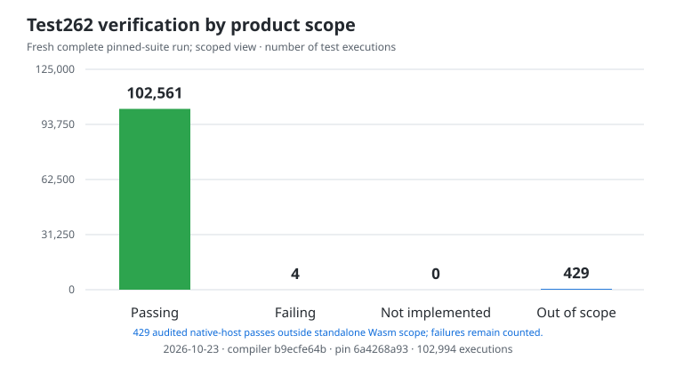

# scriptw

Scriptw is an experimental JavaScript-to-WebAssembly compiler written in Rust.
Compile JavaScript and its builtins to Wasm, run it through Wasmtime, or embed
it in a Rust application. WebAssembly is the sole output target.

## Benchmarks vs V8

Measured on 2026-10-22 at compiler source `865189051`. Medians of seven samples;
all workload outputs checked against Node. V8 is faster in these measured cases.

| Measurement | scriptw / Wasmtime | Node / V8 |
| --- | ---: | ---: |
| Cold start | 1,354.242 ms | 39.741 ms |
| Cached start | 955.276 ms | 35.109 ms |
| Execute: 10,000 integer steps | 7.081 ms | 2.376 ms |
| Execute: 500 objects | 17.072 ms | 0.057 ms |
| Execute: 8,192 retained objects | 1,506.380 ms | 3.347 ms |

| Peak process RSS | scriptw / Wasmtime | Node / V8 |
| --- | ---: | ---: |
| Cold start (median) | 382.81 MiB | 27.12 MiB |
| Cached start (median) | 349.89 MiB | 27.12 MiB |
| Retained-object run (one process) | 392.80 MiB | 53.12 MiB |

AMD EPYC 9V74; 32 GiB memory limit; four-CPU cloud quota. Both runtimes pinned
to one CPU. Wasmtime 47.0.0; Node 24.19.0 / V8 13.6.233.17-node.51.

Cold and cached starts use fresh processes with empty or populated application
caches; the shared runtime is precompiled and the OS cache is not flushed.
Execution reuses compiled code with a fresh Wasmtime Store or V8 context after
ten warmups. Process RSS includes host/runtime overhead; the retained-object
peak also includes compilation and warmups. It is not JavaScript heap usage.
The Rust compiler uses `release`; generated program modules use Fast compilation.
NativeHost and Portable have separate matching optimized runtime images.
Portable native-image storage is compressed, and decoded load buffers are
transient. The CLI is 479.10 MiB, 57.12 MiB smaller than the preceding verified
batch. These small workloads are a local baseline; short timing differences
overlap across paired controls.
[Methodology, raw evidence and reproduction](docs/rust-rewrite/v8-baseline.md).
The [performance tooling](docs/rust-rewrite/v8-baseline.md#current-performance-and-memory-tooling)
also records memory, runtime phases and code size, with selected-workload and
before/after comparisons. A selected three-sample integer run takes about three
seconds with the checked execution cache already populated.
[Prioritized performance backlog](docs/performance-hills.md).

## Tests

**Verification, 2026-10-21:** the compiler repair makes **12 of the original 16
failures pass**. A separate recheck of the remaining four still gives **0 passed,
4 failed**; ten nearby original-test controls pass. These failures remain open:

| Remaining case | Failed executions | Why it fails | Upstream tracking |
| --- | ---: | --- | --- |
| Implicit `arguments` binding | 1 | The test expects the arguments object to survive; the current specification replaces it with the block function. | [Test262 #5113](https://github.com/tc39/test262/issues/5113), [fix PR #5112](https://github.com/tc39/test262/pull/5112): open, unmerged |
| Johnston/Honolulu timezone identity | 2 | The test expects Johnston (UM) and Honolulu (US) to share an identity; country-preserving rules and historical-zone handling disagree. | [ECMA-402 #806](https://github.com/tc39/ecma402/issues/806): open, blocked; related Johnston discussion |
| Labelled block functions | 1 | Function visibility under block labels differs between the pinned specification and deployed engines. | No exact issue found; related [Annex B tracker #1595](https://github.com/tc39/ecma262/issues/1595) is open |

**All four remain counted as failures.** Upstream tracking does not change their results.
[Exact cases and verification](docs/rust-rewrite/failed-case-replay-20261021.md#remaining-four-recheck)
· [Upstream status and related issues](test262/errata/proposals/upstream-status-20261021.md).
The **2026-10-22 performance batch** passes **3,567 native tests** across seven
affected targets. Its expanded **9,207-execution Test262 replay is running**.
[Source-bound performance verification](docs/rust-rewrite/v8-baseline.md#second-execution-batch--published-2026-10-22).
The chart below reconciles that full baseline with the exact original-failure
replay and an audited standalone Wasm scope split. A fresh full run of the
repaired compiler is still pending.

<!-- scriptw-test-graph:start -->


**Reconciled checkpoints, 2026-10-21:** 102,994 mode-specific
executions at pin `6a4268a93`. This combines the complete **2026-10-20**
baseline with the exact original-failure replay: **12 repaired, 4 still failing**.
The other baseline successes have not had a fresh full rerun on the repaired compiler.

Blue is an audited **429-execution subset** focused on dynamic
`eval` / Function source compilation outside the standalone Wasm product promise.
These cases passed through the native host; their historical results remain intact.
Ordinary API properties and `call` / `apply` / `bind` stay in the measured categories.
The four bars partition the original 102,994 executions; scope is not a failure fix.
[Chart inputs and exact scope inventory](docs/rust-rewrite/test262-chart-reconciliation-20261021.json) ·
[Original complete baseline](test262/snapshots/published-status-wasm-aot.json) ·
[Failure replay](docs/rust-rewrite/failed-case-replay-20261021.md) ·
[Scope policy](docs/rust-rewrite/runtime-requirements.md#out-of-scope-tests).
<!-- scriptw-test-graph:end -->

## Caveats

- **Wasm is the sole compilation target.** C/native output and a REPL are outside scope.
- **Conformance is incomplete.** The chart identifies its measured compiler
  and complete pinned suite. [Current verification and remaining work](docs/rust-rewrite/current-inventory.md).
  [Verified repairs and original-test conflicts](docs/rust-rewrite/failed-case-replay-20261021.md).
- **Dynamic code generation is limited.** Prepared `eval` / `new Function`
  sources can run; the native host can compile additional supported sources.
  Standalone Wasm does not contain a parser or provide general runtime `eval`.
  Cases requiring a parser or VM inside emitted Wasm are outside product scope.
- **Host APIs are limited.** Scriptw is not a Node.js or browser replacement.
  Three synchronous React SSR cases work; the public browser/streaming entry
  fails. [React probe and limitations](docs/rust-rewrite/react-ssr.md).

## Wasm requirements and support

The backend requires:

- Wasm GC structs and arrays;
- reference types and typed function references;
- exception handling and tail calls;
- multi-memory and threads/shared memory.

The host must also provide the matching Scriptw runtime, `scriptw_host` imports
and Intl data. The native integration selects Wasmtime's copying collector.

| Runtime / host | Scriptw support |
| --- | --- |
| Vendored Wasmtime 47.0.0 through the Scriptw CLI or Rust API | Tested execution path |
| Browsers, Node's Wasm API and other engines | Integration and compatibility unverified; feature support alone is insufficient |
| A bare WASI host | Does not supply Scriptw's JavaScript runtime or host bindings |

[Runtime requirements and dynamic-source details](docs/rust-rewrite/runtime-requirements.md).

## Try it

Requires Rust 1.94 or newer. From a checkout:

```sh
cargo build --locked --release -p scriptw-cli --bin scriptw
printf 'print("Hello Wasm");\n' > hello.js
./target/release/scriptw run hello.js
SCRIPTW_WASM_DUMP=hello.wasm ./target/release/scriptw build wasm hello.js
```

<details>
<summary>Detailed published conformance record</summary>

## Current Status
<!-- scriptw-status:start -->
Rust rewrite status must be read in layers, not one vanity number:
- Fake wasm-safe Test262 subset: `187/187` green
- Fake full Rust rewrite suite: `191/191` green
- Pinned real Test262 baseline (`wasm-aot`, refreshed `2026-10-20`): `102978/102994` not green (`100.0%`)
- Real Test262 goal: Success=102978/102994 (100.0%); burn down NotImplemented=0, Crash=0, Bug=16 to zero
- Pinned revisions: `ecma262=5345883164f463e87f8b40aca4956157ecba8783` `test262=6a4268a9354a545d41c3b62efebc478ed8c521f4`
- Compiler build fingerprint: `53007aa326f737bd5721312044ac1e8e5981e34481941eef5707bf6c48c7380e`; executing image SHA-256: `771a15da06cbac5c7b45b24ecd8b9232af152eac9f1e24cd1e615976642ff1c6`
- Current real outcomes: `Success=102978`, `NotImplemented=0`, `Crash=0`, `Bug=16`
- Biggest current real failing kinds: `Runtime=16`
- Biggest current real failing origins: `unknown=16`
- Worst current real matrix targets: `built-ins/Object/getOwnPropertyDescriptor: 116/120 passed`, `built-ins/Object/getOwnPropertyNames: 88/90 passed`, `built-ins/parseFloat: 106/108 passed`
- Published status artifacts: `/workspace/porffor/target/scriptw-test262-refresh-20261020-run1/snapshots/scriptw-current-20261020-aggregate-13327628081868727304.json` and `/workspace/porffor/target/scriptw-test262-refresh-20261020-run1/snapshots/scriptw-current-20261020-aggregate-13327628081868727304.txt`

As of `2026-10-20`, Rust Wasm-AOT path is at 100% of repo fake coverage, not 100% ECMAScript. Project is still off literal 100% until full pinned real Test262 run is green for Rust path.

Status refresh commands:
- `cargo test -p scriptw-engine --quiet`
- `cargo test -p scriptw-cli --quiet`
- `./target/debug/scriptw test262 run language/wasm/pass --suite-root crates/scriptw-test262/tests/fixtures/fake_test262/vendor/test262 --execution-backend wasm`
- `./target/debug/scriptw test262 run --suite-root crates/scriptw-test262/tests/fixtures/fake_test262/vendor/test262`
- `./scripts/publish-real-status-low-ram.sh wasm-aot codex-published-real`

When counts move, update this block in same change. Do not claim full Test262 `100%` from fake-suite numbers.
<!-- scriptw-status:end -->

</details>

## Documentation

[Project inventory](docs/rust-rewrite/current-inventory.md) ·
[Rust architecture and development](docs/rust-rewrite/README.md) ·
[Conformance commands and shard syntax](docs/rust-rewrite/batch-workflow.md#full-test262-measurement-and-publication) ·
[Contributing](CONTRIBUTING.md) ·
[Development history](DEVELOPMENT_HISTORY.md).
