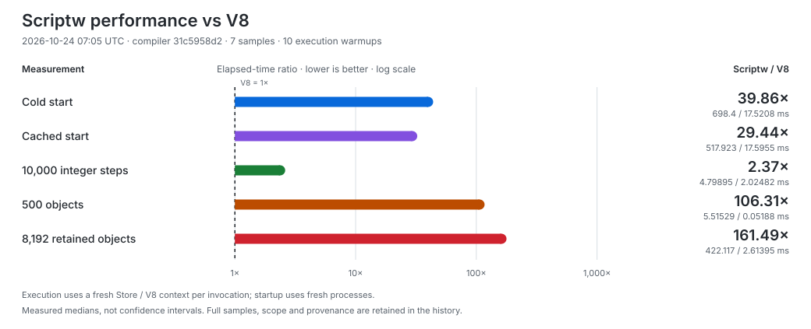
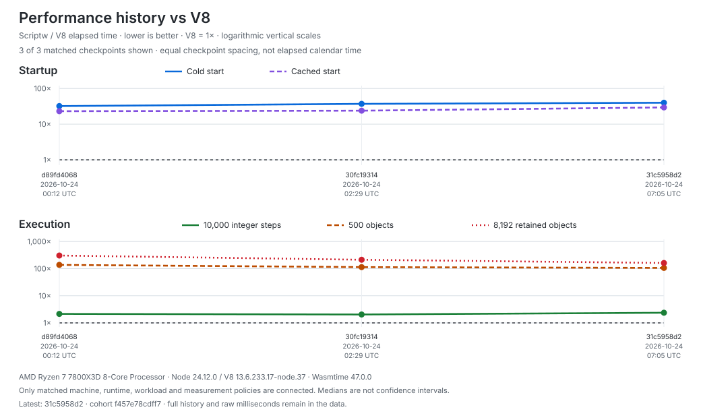

# scriptw

Scriptw is an experimental JavaScript-to-WebAssembly compiler written in Rust.
Compile JavaScript and its builtins to Wasm, run it through Wasmtime, or embed
it in a Rust application. WebAssembly is the sole output target.

Rust embedders can explicitly declare synchronous numeric foreign modules,
compile ordinary JavaScript imports, and supply implementations through their
own Wasmtime `Store` and `Linker`. ABI requirements persist in source-free
Portable bundles. See the [foreign-module contract and runnable example](docs/rust-rewrite/contracts/foreign-modules.md).

## Benchmarks vs V8

<!-- scriptw-performance:start -->
Measured **2026-10-24 07:05 UTC** at compiler `31c5958d2`; 7 samples, 10 execution warmups.





History: **3 measured checkpoints**, **1 comparison cohort**. The trend shows 3 of 3 checkpoints matching the latest setup. A new commit adds no point until it is measured.

[Raw history and evidence](docs/rust-rewrite/performance-history.json) · [Refresh commands and comparison rules](docs/rust-rewrite/contracts/performance-history.md)

| Measurement | Scriptw / Wasmtime | Node / V8 | Time / V8 |
| --- | ---: | ---: | ---: |
| Cold start | 698.400 ms | 17.521 ms | 39.86× |
| Cached start | 517.923 ms | 17.595 ms | 29.44× |
| Execute: 10,000 integer steps | 4.799 ms | 2.025 ms | 2.37× |
| Execute: 500 objects | 5.515 ms | 0.052 ms | 106.31× |
| Execute: 8,192 retained objects | 422.117 ms | 2.614 ms | 161.49× |

| Peak process RSS | Scriptw / Wasmtime | Node / V8 |
| --- | ---: | ---: |
| Cold start (median) | 388.71 MiB | 49.79 MiB |
| Cached start (median) | 358.03 MiB | 49.82 MiB |
| Retained-object run (whole child) | 405.25 MiB | 76.68 MiB |

AMD Ryzen 7 7800X3D 8-Core Processor; 1 measured CPU, 4 GiB inherited memory limit, no swap. Wasmtime 47.0.0; Node 24.12.0 / V8 13.6.233.17-node.37.

Ratios divide the two measured medians, using a logarithmic graph scale; lower is better, V8 = 1×. Startup and execution are separate boundaries. These observations establish no statistical significance.
<!-- scriptw-performance:end -->

Cold and cached starts use fresh processes with empty or populated application
caches; the shared runtime is precompiled and the OS cache is not flushed.
Execution reuses compiled code with a fresh Wasmtime Store or V8 context after
ten warmups. Scriptw initializes its Wasm realm and builtins inside execution.
Process RSS includes host/runtime overhead; the retained-object peak also
includes compilation and warmups. It is not JavaScript heap usage.
The Rust compiler uses `release`; generated program modules use Fast compilation.
NativeHost and Portable have separate matching optimized runtime images.
Portable native-image storage is compressed, and decoded load buffers are
transient. The `31c5958d2` checkpoint CLI is 264.30 MiB with line-table debug information.
These small workloads are a local baseline; short timing differences overlap
across paired controls.
[Methodology, raw evidence and reproduction](docs/rust-rewrite/v8-baseline.md).
The [performance tooling](docs/rust-rewrite/v8-baseline.md#current-performance-and-memory-tooling)
also records memory, runtime phases and code size, with selected-workload and
before/after comparisons. A selected three-sample integer run takes about three
seconds with the checked execution cache already populated.
The earlier `97036e5a8` string-hash checkpoint improved paired long-key property reads
about 83% and Map/Set lookups about 53–54%. Every string carries an extra i64 field;
two retention controls have 3–6% higher medians, with overlapping rounds.
[Measurements and tradeoffs](docs/rust-rewrite/v8-baseline.md#cached-string-hash-checkpoint--published-2026-10-23).
[Retained-row phase profiles](docs/rust-rewrite/performance-row-phases-20261023.md)
identify collector work as 83–84% of construction samples; traversal is dominated by property reads.
[Prioritized performance backlog](docs/performance-hills.md).
[Compact ordinary storage and guarded read-cache contract](docs/rust-rewrite/contracts/compact-ordinary-data-storage.md).

[Performance implementation and resource limits](docs/rust-rewrite/v8-performance-program.md)
track guarded property reads, packed arrays, scalar lowering, startup reuse
and explicit GC/native-code experiments. The
[measured checkpoint and tradeoffs](docs/rust-rewrite/performance-six-workstreams-20261024.md)
reports about 17% faster object workloads and 50% faster retained execution
against its frozen compiler control. Sustained arrays regress about 3%; several
small storage controls also regress. Separate existing-Realm measurements still
show a large V8 gap. Refresh commands, exact scopes and identities are in that
report; these results do not establish V8 parity.
[Bounded native verification workflow](docs/rust-rewrite/batch-workflow.md#optional-sequential-cli-chunks).

## Tests

**Full verification, 2026-10-23:** **102,990 passed / 4 failed / 0 crashed /
0 unimplemented** across all 102,994 pinned Test262 executions, using compiler
`b9ecfe64b`. The 12 repaired failures stay fixed; no new failures appeared.
These four failures remain open (upstream status checked 2026-10-21):

| Remaining case | Failed executions | Why it fails | Upstream tracking |
| --- | ---: | --- | --- |
| Implicit `arguments` binding | 1 | The test expects the arguments object to survive; the current specification replaces it with the block function. | [Test262 #5113](https://github.com/tc39/test262/issues/5113), [fix PR #5112](https://github.com/tc39/test262/pull/5112): open, unmerged |
| Johnston/Honolulu timezone identity | 2 | The test expects Johnston (UM) and Honolulu (US) to share an identity; country-preserving rules and historical-zone handling disagree. | [ECMA-402 #806](https://github.com/tc39/ecma402/issues/806): open, blocked; related Johnston discussion |
| Labelled block functions | 1 | Function visibility under block labels differs between the pinned specification and deployed engines. | No exact issue found; related [Annex B tracker #1595](https://github.com/tc39/ecma262/issues/1595) is open |

**All four remain counted as failures.** Upstream tracking does not change their results.
[Exact cases and verification](docs/rust-rewrite/failed-case-replay-20261021.md#remaining-four-recheck)
· [Upstream status and related issues](test262/errata/proposals/upstream-status-20261021.md).
The earlier `97036e5a8` checkpoint passed **4,083 native tests** across twelve
affected targets and eighteen compiled semantic families. Its **13,104-case
Test262 replay** has **13,100 passes and the same four failures**; the full chart
below remains bound to `b9ecfe64b`. Native acceptance includes two complete
target reruns after test-only fixture/trace repairs.
[Full-run evidence](docs/rust-rewrite/test262-current.md) ·
[Latest checkpoint](docs/rust-rewrite/v8-baseline.md#cached-string-hash-checkpoint--published-2026-10-23).
The [performance checkpoint](docs/rust-rewrite/performance-six-workstreams-20261024.md)
reports its own native checks and selected original-case replay. The full
chart below remains bound to `b9ecfe64b`.

The [foreign-module checkpoint](docs/rust-rewrite/contracts/foreign-modules.md#verified-checkpoint-2026-10-24),
refreshed 2026-10-24 at `559151e32`, passed **5,662 affected native checks**
and the ordinary custom-Linker example (`42`). Its complete module-code and
Function apply/bind/call subsets plus known-failure controls passed
**980 / 984 executions**, with the same four failures
and zero crashes, unsupported cases or timeouts. The linked checkpoint retains
refresh commands and exact inventories; it does not replace the full chart.

<!-- scriptw-test-graph:start -->


**Fresh full run, 2026-10-23:** 102,994 mode-specific
executions at pin `6a4268a93`, compiler `b9ecfe64b`.
All executions belong to this compiler; no earlier failure replay is mixed in.

Blue is the unchanged audited **429-execution subset** focused
on dynamic `eval` / Function source compilation outside the standalone Wasm promise.
These cases passed through the native host in this run. Ordinary API properties
and `call` / `apply` / `bind` stay in the measured categories.
The four bars partition all 102,994 executions; scope cannot hide a failure.
[Portable native snapshots and exact scope inventory](docs/rust-rewrite/test262-chart-full-20261022.json) ·
[Complete published result](test262/snapshots/published-status-wasm-aot-857165c90f0fb4ac3ec0493a3b4470977007808c5b1c10ecf5512840edc80f46.json) ·
[Scope policy](docs/rust-rewrite/runtime-requirements.md#out-of-scope-tests).
<!-- scriptw-test-graph:end -->

## Caveats

- **Wasm is the sole compilation target.** C/native output and a REPL are outside scope.
- **Conformance is incomplete.** The chart identifies its measured compiler
  and complete pinned suite. [Current verification and remaining work](docs/rust-rewrite/current-inventory.md).
  [Verified repairs and original-test conflicts](docs/rust-rewrite/failed-case-replay-20261021.md).
- **Dynamic code generation is limited.** Prepared `eval` / `new Function`
  sources can run; the native host can compile additional supported sources.
  Standalone Wasm does not contain a parser or provide general runtime `eval`.
  Cases requiring a parser or VM inside emitted Wasm are outside product scope.
- **Host APIs are limited.** Scriptw is not a Node.js or browser replacement.
  Three synchronous React SSR cases work; the public browser/streaming entry
  fails. [React probe and limitations](docs/rust-rewrite/react-ssr.md).

## Wasm requirements and support

The backend requires:

- Wasm GC structs and arrays;
- reference types and typed function references;
- exception handling and tail calls;
- multi-memory and threads/shared memory.

The host must also provide the matching Scriptw runtime, `scriptw_host` imports
and Intl data. The native integration selects Wasmtime's copying collector.

| Runtime / host | Scriptw support |
| --- | --- |
| Vendored Wasmtime 47.0.0 through the Scriptw CLI or Rust API | Tested execution path |
| Browsers, Node's Wasm API and other engines | Integration and compatibility unverified; feature support alone is insufficient |
| A bare WASI host | Does not supply Scriptw's JavaScript runtime or host bindings |

[Runtime requirements and dynamic-source details](docs/rust-rewrite/runtime-requirements.md).

## Try it

Requires Rust 1.94 or newer. From a checkout:

```sh
cargo build --locked --release -p scriptw-cli --bin scriptw
printf 'print("Hello Wasm");\n' > hello.js
./target/release/scriptw run hello.js
SCRIPTW_WASM_DUMP=hello.wasm ./target/release/scriptw build wasm hello.js
```

<details>
<summary>Detailed published conformance record</summary>

## Current Status
<!-- scriptw-status:start -->
Rust rewrite status must be read in layers, not one vanity number:
- Fake wasm-safe Test262 subset: `187/187` green
- Fake full Rust rewrite suite: `191/191` green
- Pinned real Test262 baseline (`wasm-aot`, refreshed `2026-10-23`): `102990/102994` not green (`100.0%`)
- Real Test262 goal: Success=102990/102994 (100.0%); burn down NotImplemented=0, Crash=0, Bug=4 to zero
- Pinned revisions: `ecma262=5345883164f463e87f8b40aca4956157ecba8783` `test262=6a4268a9354a545d41c3b62efebc478ed8c521f4`
- Compiler build fingerprint: `7337ccbc2834d0d17902382431789227b6dddf8fda40842bf19c4243161d56f9`; executing image SHA-256: `32ee09a9a33daaf7d27fcb1b649db7223fcbd3ce00f0943cf19cce5ef886101b`
- Current real outcomes: `Success=102990`, `NotImplemented=0`, `Crash=0`, `Bug=4`
- Biggest current real failing kinds: `Runtime=4`
- Biggest current real failing origins: `unknown=4`
- Worst current real matrix targets: `intl402/Temporal/ZonedDateTime: 248/250 passed`, `annexB: 1376/1377 passed`, `staging/sm/lexical-environment: 38/39 passed`
- Published status artifacts: `/workspace/scriptw-full-suite-20261022/test262/snapshots/scriptw-hot-reads-b9ecfe64b-20261022-aggregate-13327628081868727304.json` and `/workspace/scriptw-full-suite-20261022/test262/snapshots/scriptw-hot-reads-b9ecfe64b-20261022-aggregate-13327628081868727304.txt`

As of `2026-10-23`, Rust Wasm-AOT path is at 100% of repo fake coverage, not 100% ECMAScript. Project is still off literal 100% until full pinned real Test262 run is green for Rust path.

Status refresh commands:
- `cargo test -p scriptw-engine --quiet`
- `cargo test -p scriptw-cli --quiet`
- `./target/debug/scriptw test262 run language/wasm/pass --suite-root crates/scriptw-test262/tests/fixtures/fake_test262/vendor/test262 --execution-backend wasm`
- `./target/debug/scriptw test262 run --suite-root crates/scriptw-test262/tests/fixtures/fake_test262/vendor/test262`
- `./scripts/publish-real-status-low-ram.sh wasm-aot codex-published-real`

When counts move, update this block in same change. Do not claim full Test262 `100%` from fake-suite numbers.
<!-- scriptw-status:end -->

</details>

## Documentation

[Project inventory](docs/rust-rewrite/current-inventory.md) ·
[Rust architecture and development](docs/rust-rewrite/README.md) ·
[Conformance commands and shard syntax](docs/rust-rewrite/batch-workflow.md#full-test262-measurement-and-publication) ·
[Contributing](CONTRIBUTING.md) ·
[Development history](DEVELOPMENT_HISTORY.md).
