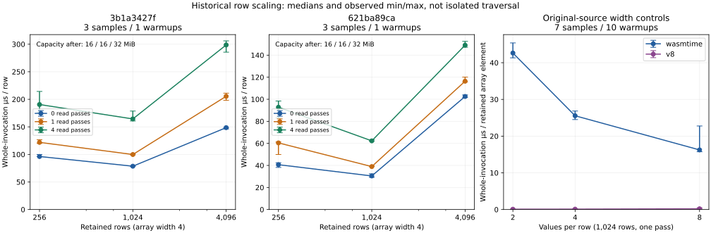

# Retained-row scaling analysis — 2026-10-23

The preserved measurements show a large increase in cost per row between 1,024
and 4,096 retained rows. This completes **P003 as a diagnostic**, using existing
measurements rather than another benchmark campaign. It does not claim a new
optimization or current-product performance.



The [derived data](performance-row-scaling-20261023/row-scaling.json) records all
21 cases, their original samples, source and executable identities, normalized
costs and capacity observations. The [first-wave evidence](performance-first-wave-20261022.json)
contains the original byte-verified reports and JavaScript fixtures.

## What the measurements establish

The two row-count screens use widths of four array elements, row counts
256/1,024/4,096, and zero/one/four read passes. Each screen has three samples
after one warmup. Even the zero-pass case includes the final length/element
checksum. Construction-only medians are:

| Rows | Original `3b1a3427f` | First-wave `621ba89ca` | Capacity after, both sources |
| ---: | ---: | ---: | ---: |
| 256 | 24.626 ms | 10.410 ms | 16 MiB |
| 1,024 | 80.506 ms | 31.182 ms | 16 MiB |
| 4,096 | 608.630 ms | 419.958 ms | 32 MiB |

Increasing rows fourfold from 1,024 to 4,096 increases those elapsed medians by
**7.56× and 13.47×**, respectively. Cost per row rises about **1.89× and 3.37×**.
The capacity change occurs between the measured sizes; these points do not locate
an exact threshold or prove that collection causes the additional cost. Capacity
is neither live heap nor a count of allocations or collections.

The separate original-source width controls hold 1,024 rows and one read pass
fixed while varying array widths 2/4/8. They use **seven samples after ten
warmups**, with the same original executable and machine. Their Wasmtime medians
are 87.320/104.633/133.045 ms. The right panel divides the whole invocation by
the number of retained array elements (`rows × width`); it does not divide by
read operations or remove object construction. The JSON also retains per-row
normalization and the V8 observations.

Error bars show observed minima and maxima, not confidence intervals. The width
controls run separately from the row-count screens, and the two compiler sources
differ. These plots do not isolate individual compiler changes, GC cost, or
traversal-only time. They retain all samples and subtract no setup estimate.

## Next investigation

Profile the current product's retained-row execution around the existing
execution/completion span, using construction and read-pass controls. Keep
compilation, warmups and sampler-control overhead separately identified. This
is the remaining P001/P002 work; another broad geometric sweep is unnecessary
before that attribution. A named traversal function alone does not provide a
separately timed traversal measurement.

## Reproduce the analysis

The generator checks both compressed and decoded asset digests, fixture hashes,
Wasmtime/V8 output checksums, sample and warmup counts, medians and measured
module-cache hits. It preserves the distinct cohort policies. Plotting requires
`matplotlib`; JSON-only analysis uses the Python standard library.

From the cloud checkout used for these reports:

```sh
MPLCONFIGDIR=/tmp/scriptw-row-scaling-matplotlib \
python3 -B scripts/limited_verification.py --cloud -- \
  python3 -B scripts/analyze-performance-row-scaling.py \
  --output-dir docs/rust-rewrite/performance-row-scaling-20261023 --plot
```

No JavaScript, Wasmtime or compiler benchmark runs during this analysis.
