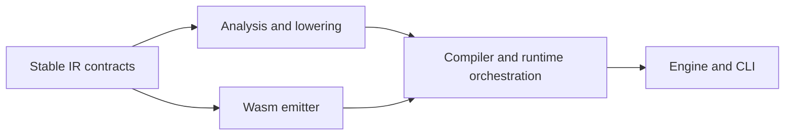

# Verification costs and useful crate boundaries — 2026-10-12

The 2026-10-13 optimized checkpoint completes three fresh full corpus rounds
per ordinary/private image, all 704 nightly and all 1,216 robustness cases.
Exact prior passing IDs, request bytes/order and original deadlines remain,
with zero missing IDs or regressions. See the
[portable optimized record](optimized-worker-checkpoint-20261013.json).

| Optimized owner | Observed wall time | Scope |
| --- | ---: | --- |
| First release graph | 1,967 s | Actual CLI and selected differential-worker binaries; 474 artifacts |
| Embedded runtime precompile | 552.237 s | One CPU; 1,013 function-cache hits and 1,140 misses |
| Warm ordinary build | 0.502 s | Unchanged release graph |
| Private shared-worker link | 1.821 s | Ordinary output restored byte-for-byte |
| Ordinary corpus median | 32.208 s | Three complete fresh fourteen-entry rounds |
| Shared/stripped corpus median | 21.201 s | Three complete fresh fourteen-entry rounds |
| Optimized nightly | 1,219.103 s | All 704 cases, original 5,000 ms requests |
| Optimized robustness | 467.494 s | All 1,216 seeds, original 300,000 ms bounds |

The private release worker is 131,047,560 bytes; ordinary is 499,663,192.
Both images repeat all aggregate/input/report bytes exactly within their three
rounds and retain every historical semantic observation. These consecutive
unbalanced timings are observations, not a controlled speedup claim. The
earlier balanced debug experiment below establishes its separate 19.6% gain.
The first dependency build and serial runtime precompilation are substantial
costs; retaining the release graph makes an unchanged build half a second.
Idle default optimized performance and full current-pin/task acceptance remain
separate. No memory-working-set reduction is inferred from executable size.

The independent default-feature run completes on 2026-10-13 with 8,881 passes,
zero failures and zero ignores across all 105 scopes. Its full CLI inventory is
848, distinct from the all-feature 855 below. During its parallel continuation,
the runner reaches the isolated CLI and drains Intl/RegExp before opening later
independent work. The Python-only repair dispatches independent targets first
while preserving receipt order/indices and all idle barriers. Four focused queue
controls pass; no controlled full-sweep scheduling speedup is claimed. Eight
reversible SHA-verified debug-library archives reclaim about 5.74 GB net before
the separate optimized graph. See the
[default checkpoint](native-default-checkpoint-20261013.json).

These are observed timings on this cloud machine (four-CPU inherited quota,
32-GiB inherited memory cap, serial Cargo, one CPU/thread per native process).
The historical timings below are not controlled before/after speedup claims;
the separate worker experiment below is a controlled comparison. Original cases, fixtures,
pins and deadlines remain acceptance requirements.

| Check | Observed wall time | Scope |
| --- | ---: | --- |
| Matching debug CLI build | 19.740 s | 391 artifact records; three new leaf units |
| Warm complete type check | 69 s | All workspace features and targets |
| Complete type check after IR edit | 458.508 s | Same complete scope; IR/build dependencies rebuilt |
| Original structural preflight | 0.202 s | Build, inventory and execute three unchanged source-only controls |
| Tooling tests | 149.145 s | 479 Python methods on the prior source |
| Current tooling tests | 146.957 s | All 491 Python methods |
| Focused GC native build | 492.836 s | Two Cargo-selected native test executables |
| Focused GC native execution | 10.591 s | 25 controls, including four new controls |
| Compiled corpus | 40.883 s | All fourteen entries |
| Debug nightly campaign | 2,236.618 s | All 704 cases; every prior passing ID retained |
| Debug robustness campaign | 1,024.212 s | Original nineteen targets × 64 inputs |
| Initial native documentation cohort | 475.344 s | All thirteen packages; count this shared time once |

Raw source-bound results are retained under `target/weak-index-*20261012`.
The [portable checkpoint](weak-index-repair-20261012.json) preserves exact
comparisons and the native failure, separate from the passing campaigns.
That earlier complete native attempt was incomplete: 44 scopes executed 4,526
IDs, with 4,525 passes and one structural regression; 62 scopes remain
unstarted or storage-deferred. Its red evidence remains unchanged. The subsequent
clean `f54ef2ae9` run completes all 106 all-feature scopes with 8,974 passes,
zero failures and zero ignores, retaining all prior passing IDs. Independent
optimized acceptance remains required. See the
[complete comparison and worker experiment](native-worker-checkpoint-20261012.json).

| Complete-run component | Observed wall time | Scope |
| --- | ---: | --- |
| Engine library | 603.554 s | 874 controls |
| Engine builtins | 543.257 s | 496 controls |
| Engine GC entries | 240.662 s | 162 controls |
| Engine generators | 433.036 s | 167 controls |
| Engine Intl | 1,811.754 s | 290 controls; selected runtime projections dominate |
| CLI | 942.564 s | All 855 controls in four exact partitions |
| Isolated Intl library | 147.760 s | 634 controls |
| Normal documentation cohort | 459.614 s | Twelve packages, seven doc controls |
| Isolated Intl documentation | 3 s | Four doc controls |

The main run took 6,128 seconds and deferred nine scopes for storage. Identical-
source native continuations took 627 seconds, followed by three seconds for
isolated docs. These observations identify expensive components; they do not
establish a controlled scheduling improvement.

## Immediate iteration work

Keep Cargo feature/profile graphs stable and reuse only artifacts Cargo actually
selects as fresh. A prior all-feature CLI build took 567.09 seconds and rebuilt
ten units, including Boa, AOT and the runtime image; Wasmtime/Cranelift were
already fresh. The later 19.740-second build reused those dependencies.

The native runner previously bypassed package isolation for its documentation
cohort. Its repaired cohorts keep normal roots separate from each isolated root,
retain every selected package, record per-package inventory hashes and preserve
idle execution. Cached native ELFs require no link reserve; real builds and
fallback static-to-shared relinks require the original two-GiB disk reserve.
Storage waiting polls as before but prints at most once per twenty seconds.

A live Cargo/rustc sample showed one-CPU affinity and about 99% CPU while no
native test remained, despite the four-CPU quota. The blocking build call kept
the launch-time restriction after the tests had exited. The runner now polls
the build and expands only its descendant task masks to the inherited budget
after all native wrappers exit. Cargo remains serial; native masks and deadlines
remain unchanged. Native cleanup still waits until Cargo releases its lock.
The first external monitor arrived after Cargo completed and made zero changes;
it establishes no measured speedup. Fresh run receipts record actual changes.
The live child/thread/grandchild probe passes on the frozen helper; its parent
mask stays unchanged. The [tooling checkpoint](verification-runner-20261012.json)
records that probe, all thirteen guards, current tooling, types and nine Intl
freshness checks. The 458.508-second check follows an IR source edit and rebuilds
IR build dependencies, unlike the earlier warm 69-second check. Neither timing
is a controlled comparison of the new scheduling policy.

## Repeated process costs

The nightly campaign records 768 replay attempts for 704 seeds (the metamorphic
grammar also executes transformed inputs), implying 1,536 backend worker
launches. Robustness launches 1,216 workers. Each worker captures compiler
identity by hashing its loaded executable once; the current debug CLI is
500,027,960 bytes. Together those requests scan about 1.38 TB of executable
bytes. This is derived scan volume, not measured disk I/O: the page cache may
satisfy those reads. Current campaign receipts do not attribute elapsed time to
hashing, runtime admission/deserialization, input compilation or execution.

Minimal runtime R is already source/target/configuration-bound and precompiled;
Conformance R is not precompiled.
The native test linker shares its verified immutable data through a DSO.
Wasmtime's native Module cache already shares across executable images, binding
Wasm bytes and engine/compiler configuration. The raw runtime-artifact cache
still binds the full compiler image; removing that identity requires a complete
target/feature/build/source key. Fresh processes still require admission and
deserialization. A bounded persistent differential/robustness worker could amortize
identity capture and immutable runtime loading. The existing opt-in Test262
server gives a model: at most 64 supervised requests, original per-request
deadlines, exact request/journal/provenance checks, and a fresh Engine, Realm,
Store, GC state and native-agent ownership each time. Timeout or protocol failure
must retire the group; no JS state or verdict may carry to another case.
Measure this on identical requests before claiming a gain.

## Measured reusable private workers

On an idle machine, seven balanced startup/identity samples and three balanced
complete fourteen-case corpus rounds per image use the same frozen source,
unchanged requests/deadlines and fresh caches/output directories. Identity time
includes whole process startup and hashing the actual loaded image.

| Debug image | Executable bytes | Median startup/identity | Median full corpus |
| --- | ---: | ---: | ---: |
| Ordinary | 500,028,352 | 0.401613 s | 40.149327 s |
| Stripped private copy | 281,586,664 | 0.208624 s | 34.655253 s |
| Shared and stripped private copy | 161,621,512 | 0.124126 s | 32.299623 s |

All nine complete replays pass fourteen cases. Repeated aggregate/input/report
bytes agree for each image; between images every semantic field agrees while
actual worker hashes remain distinct. The shared/stripped full corpus is 19.6%
faster. The ordinary size above belongs to this experiment; the earlier campaign
image was 500,027,960 bytes. Identical file-backed images already share physical
pages; these measurements establish image/hash/link-size gains, not a measured
memory-working-set reduction.

The reusable opt-in tool performs only a private leaf link, verifies the three
shared arrays and all allocated ELF sections, restores ordinary Cargo output
byte-for-byte, and records actual compiler identities. Fresh debug private link
takes 1.715 seconds; warm Cargo selection takes 0.375 seconds. Ordinary-controller/
private-worker complete replay also passes. Example:

```sh
python3 -B scripts/limited_verification.py --cloud --cloud-cpus auto -- \
  python3 -B scripts/stage-verification-worker.py \
  --oracle --share-runtime-images --output target/verification-worker-FRESH
python3 -B scripts/limited_verification.py --cloud -- \
  target/debug/lila --jobs 1 differential replay-corpus --oracle spec-exec \
  --worker-bin target/verification-worker-FRESH/lila-worker \
  --output-dir target/corpus-FRESH
```

`--profile release` selects optimized Cargo output. Optimized staging and
ordinary-controller/private-worker replay now pass in the 2026-10-13 checkpoint
above. Oracle enablement remains an explicit developer option.
Custom Intl projections alter emitted code and interned string offsets, so
precompiling arbitrary Conformance-R projections requires a real code/data seam;
it is not a data-file substitution. Crate splitting below remains a proposal.

## Crate split with a useful dependency cut

IR is roughly 7.94 MB of Rust source and AOT roughly 12.22 MB. Engine is roughly
1.94 MB, much of its largest file being inline unit tests. IR, Intl and AOT
already use optimization level two in dev/test; frontend, Engine and CLI use
zero; Wasmtime/Cranelift and other external dependencies use two. Release uses
its normal optimized profile without LTO or one-codegen-unit rebuild costs.

The best candidate is a stable IR contract crate containing the typed IR,
closed builtin/name/protocol domains and other emitter inputs, while the existing
IR crate owns frontend analysis and lowering. AOT would depend on the contract.
Lowering-only changes could then rebuild lowering and orchestration while
reusing AOT. Contract changes must still invalidate their consumers.

There is a production edge to remove first: AOT's runtime-artifact builder
currently parses and lowers the runtime bootstrap. Move that orchestration to
Engine or a small runtime-builder crate, which depends on both lowering and
AOT; provide AOT the prepared runtime artifact. Adding a types crate while
leaving this call inside AOT would retain the expensive dependency edge.



A second candidate separates Intl data/layout/wire contracts from provider
algorithms so provider edits stop invalidating the emitter. Collator data already
has a data-only crate, and other data producers already have narrow declared
inputs; another data-only split alone has less certain benefit. Splitting the
emitter by builtin family is less attractive because its planning, local,
GC-root and control-frame state is private and shared.

Prototype the dependency cut and measure a real lowering-only edit through
normal Cargo. Rust libraries remain compiler/profile/feature/dependency-specific;
do not treat an old `.rlib` as a universal precompiled ABI or force freshness.
Compiler/host ABI identities and every full-suite acceptance gate remain intact.
